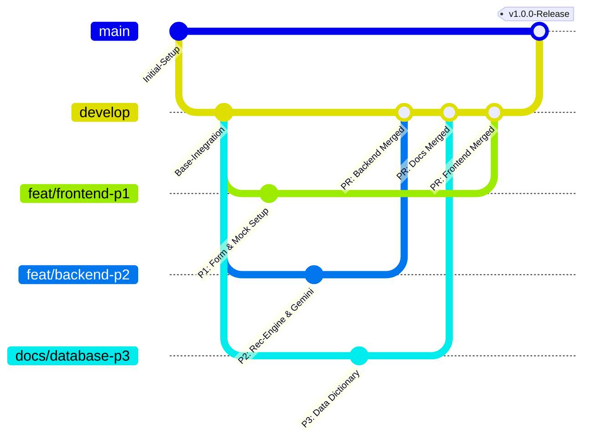

# Git Workflow & Team Collaboration Guide

## 1. Collaboration Philosophy & Team Boundaries

To allow **Person 1 (Frontend)**, **Person 2 (Backend)**, and **Person 3 (Database & Documentation)** to work at maximum velocity without stepping on each other's code, we follow a **Domain-Isolated Feature Branch Workflow**.

Because the repository is cleanly divided into `/client`, `/server`, and `/team-planning`, team members rarely modify the same physical files.

### Primary Folder Ownership:
* **Person 1**: Exclusively owns `client/`
* **Person 2**: Exclusively owns `server/` (controllers, routes, services, middleware)
* **Person 3**: Exclusively owns `team-planning/`, test reports, and seed data reviews in `server/seed/`

---

## 2. Git Branch Strategy



### Branch Naming Conventions:
* **Frontend**: `feat/frontend-<task-name>` (e.g., `feat/frontend-recommendation-sliders`)
* **Backend**: `feat/backend-<task-name>` (e.g., `feat/backend-gemini-fallback`)
* **Database & Docs**: `docs/db-<task-name>` (e.g., `docs/db-field-dictionary`)
* **Bug Fixes**: `fix/<issue-name>` (e.g., `fix/auth-token-refresh`)

---

## 3. Pull Request & Code Review Process

1. **Short-Lived Branches**: Keep branches focused on a single milestone task (1–3 days max).
2. **Pull Request Protocol**:
   * Open PR against the `develop` branch.
   * Provide a clear PR description:
     * **What was changed**: Summary of edits.
     * **Verification performed**: Screenshots, cURL output, or Compass records.
     * **Affected modules**: Specific files touched.
3. **Review Assignments**:
   * PRs modifying `server/`: Must be reviewed by Person 2 (lead) and verified by Person 3 (for database impact).
   * PRs modifying `client/`: Must be reviewed by Person 1 (lead) and checked by Person 2 (for API contract conformance).
   * PRs modifying schemas or API contracts: Must be approved by **all three members**.
4. **Merge Rule**: Minimum of 1 approval required before merging into `develop`. `main` is protected and updated only during major milestone tags.

---

## 4. How to Manage API & Schema Contract Changes

Contracts prevent communication breakdowns. If either the frontend or backend requires a modification to an API endpoint or database field:

1. **Do NOT Silently Change Code**: A developer must never change a route URL, request parameter, or response key without prior notice.
2. **Open an Issue / Message**: Propose the change in the team channel with the rationale (e.g., *"Need to add `latencyTargetMs` to `/api/projects/:id/requirements` payload"*).
3. **Update the Contract First**: Update [API_INTEGRATION_CONTRACT.md](file:///c:/Users/ACER/Desktop/NTCC/team-planning/API_INTEGRATION_CONTRACT.md) or [DATABASE_SCHEMA_PLAN.md](file:///c:/Users/ACER/Desktop/NTCC/team-planning/DATABASE_SCHEMA_PLAN.md).
4. **Both Parties Sign Off**: Person 1 and Person 2 confirm the change.
5. **Implement Code**: Person 2 updates the controller/model; Person 1 updates Axios calls.

---

## 5. Security, Secrets & Environment Protection

1. **Never Commit Secrets**:
   * Neither `.env` nor credentials may ever be committed to Git.
   * Both [client/.gitignore](file:///c:/Users/ACER/Desktop/NTCC/client/.gitignore) and [server/.gitignore](file:///c:/Users/ACER/Desktop/NTCC/server/.gitignore) explicitly ignore `.env` and `node_modules/`.
2. **Environment Template Maintenance**:
   * Any new environment variable must be added to `.env.example` with dummy values:
   * **Server** (`server/.env.example`):
     ```env
     PORT=5000
     MONGODB_URI=mongodb://localhost:27017/architecture-advisor
     JWT_SECRET=your_jwt_secret_key_here
     CLIENT_URL=http://localhost:5173
     GEMINI_API_KEY=your_gemini_api_key_here
     ```
   * **Client** (`client/.env.example`):
     ```env
     VITE_API_BASE_URL=http://localhost:5000/api
     ```

---

## 6. Avoiding & Resolving Merge Conflicts

Because files are cleanly separated by domain, merge conflicts will be rare. When conflicts do occur:

1. **Pull `develop` Daily**:
   ```bash
   git checkout develop
   git pull origin develop
   git checkout feat/your-branch
   git merge develop
   ```
2. **Package Lock Conflicts**:
   * If `package-lock.json` conflicts occur, re-run `npm install` on the branch rather than manually editing the lockfile.
3. **Communication**: If a conflict arises in shared configuration files (e.g., root `.gitignore` or `package.json`), both involved members resolve it together via screen share or live chat.

---

## 7. Pre-Merge Verification Checklist

Before opening any Pull Request to merge into `develop`, the author must verify:

- [ ] **No Secrets**: Confirm no `.env` or credentials are staged (`git status`).
- [ ] **Clean Lint & Build**:
  * Frontend: `npm run build` succeeds without JSX or syntax errors.
  * Backend: `node server.js` boots and logs database connection without crashes.
- [ ] **API Contract Adherence**: Any updated payload exactly matches `API_INTEGRATION_CONTRACT.md`.
- [ ] **Database Integrity**: Compass inspection confirms no corrupted or malformed documents were inserted.
- [ ] **Branch Up-to-Date**: Branch has merged latest changes from `develop`.
