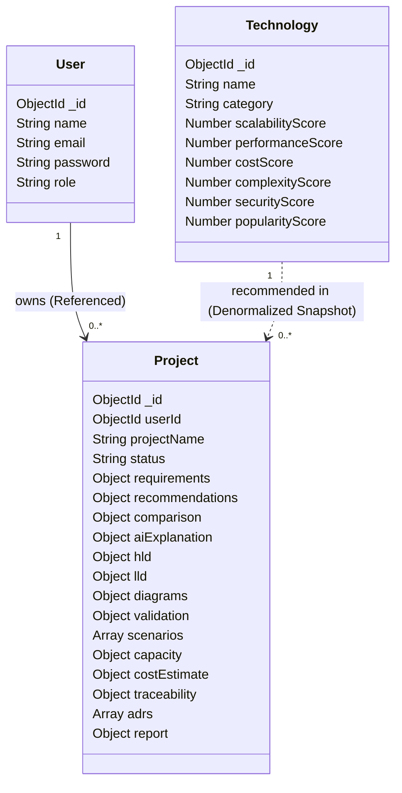

# Person 3: Database & Documentation Manager Workstream Plan

## 1. Role & Scope
* **Primary Owner**: Person 3 (Database & Documentation Manager)
* **Profile**: Database governance, documentation, testing, and data validation manager. Work is structured so it can be completed immediately using visual and documentation tools (MongoDB Compass, MongoDB Atlas, spreadsheets, Markdown, and API testing tools like Postman/Thunder Client) without requiring prior coding proficiency.
* **Core Responsibilities**:
  * Oversee MongoDB Atlas / local MongoDB environments.
  * Maintain field-level data dictionaries, BSON schemas, validation rules, and sample JSON documents.
  * Manage seed data for technologies and demonstration projects using MongoDB Compass.
  * Conduct black-box API testing and database CRUD verification.
  * Maintain system documentation, testing checklists, defect logs, and disaster recovery / backup guides.

---

## 2. Phase A: Immediate Work (No Coding Required)

Person 3 can begin work on these 15 tasks on Day 1:

1. **Page-by-Page Data Audit**: Review every frontend view and record what data fields are displayed or captured on that page.
2. **Collection Inventory**: Document the collections in the system (`users`, `technologies`, `projects`).
3. **Field-Level Data Dictionary**: Maintain a master spreadsheet specifying Field Name, Parent Collection, BSON Data Type, Required (Yes/No), Default Value, Valid Enums, and Description.
4. **Schema Diagram Creation**: Create visual Entity-Relationship and Document-Embedding diagrams showing how collections connect.
5. **Sample JSON Document Library**: Create valid, representative JSON documents for each collection in a `/sample-data` folder.
6. **Reference Mapping**: Document the foreign key links:
   * `projects.userId` $\rightarrow$ `users._id`
   * `projects.recommendations.*.name` $\rightarrow$ `technologies.name`
7. **MongoDB Compass Setup & Mastery**: Install MongoDB Compass; connect to `mongodb://localhost:27017/architecture-advisor` or MongoDB Atlas; practice filtering, inserting, and querying documents.
8. **Technology Catalog Review**: Review the 20+ technologies in `server/seed/techSeeder.js` (Frontend, Backend, Database, Cache, Messaging, Cloud) and verify all score properties (1–10) are populated.
9. **Seed Data Preparation**: Prepare a ready-to-import JSON file for the technology catalog.
10. **Database Connection & Security Guide**: Write setup documentation explaining how to configure `.env` variables (`MONGODB_URI`) safely without committing passwords to GitHub.
11. **Database Index Documentation**: Document all required indexes (compound index `{ userId: 1, createdAt: -1 }`, text index `{ projectName: "text" }`, unique index on `users.email`).
12. **Data Integrity & Validation Rules**: Document schema constraints (e.g., minimum password length, valid email regex, allowed application types).
13. **CRUD Verification Checklist**: Create a step-by-step checklist to test each CRUD operation in MongoDB Compass after backend operations occur.
14. **Questions & Decisions Log for Person 2**: Maintain a running log of schema questions or edge-case handling for discussion with Person 2.
15. **User Test Scenarios**: Write 5 end-to-end user evaluation stories (e.g., "High-volume competitive programming judge", "E-commerce marketplace with payments", "B2B SaaS reporting dashboard").

---

## 3. Analysis of the 10 Potential Collections (Embedded vs. Referenced)

In MongoDB document modeling, a fundamental design decision is whether related information should be **Embedded** within a parent document or **Referenced** in a separate collection.

Based on our audit of [server/models/Project.js](file:///c:/Users/ACER/Desktop/NTCC/server/models/Project.js), [User.js](file:///c:/Users/ACER/Desktop/NTCC/server/models/User.js), and [Technology.js](file:///c:/Users/ACER/Desktop/NTCC/server/models/Technology.js), here is the official architectural breakdown:



### Detailed Evaluation of Each Candidate Collection:

| Candidate Collection | Existing or Proposed | Final Design Strategy | Rationale & Query Pattern |
| :--- | :--- | :--- | :--- |
| **`users`** | **Existing** | **Separate Referenced Collection** | Users authenticate independently of projects. A single user owns multiple projects (1-to-many relationship). Storing users separately allows secure password isolation, independent indexing on `email`, and role-based access. |
| **`technologies`** | **Existing** | **Separate Referenced Collection** | The technology catalog is a global knowledge base shared across all users and projects. It is updated independently (via admin or seed scripts) and read frequently by the recommendation engine. |
| **`projects`** | **Existing** | **Core Aggregate Collection** | The primary business entity. Holds project metadata and acts as the aggregate root for all downstream architectural stages. |
| **`requirements`** | Evaluated | **Embedded within `projects`** (`project.requirements`) | Requirements have a strict 1-to-1 relationship with the project. They are never queried without loading the project. Embedding guarantees atomic reads and updates in a single database round-trip. |
| **`recommendations`** | Evaluated | **Embedded within `projects`** (`project.recommendations`) | Recommendations represent the state of an evaluation run for that specific project. Embedding preserves a point-in-time snapshot of scores and rationale even if the global technology catalog changes later. |
| **`architectureDocuments`** (HLD/LLD) | Evaluated | **Embedded within `projects`** (`project.hld`, `project.lld`) | High-level and low-level designs belong strictly to one project. Total document size is well under MongoDB's 16MB document limit (~50KB average). Embedding avoids complex `$lookup` aggregation joins. |
| **`architectureDecisions`** (ADRs) | Evaluated | **Embedded Array within `projects`** (`project.adrs`) | A project typically has 5 to 20 ADRs. Embedding them as an array of sub-documents allows atomic additions and updates directly within the project workflow. |
| **`scenarios`** | Evaluated | **Embedded Array within `projects`** (`project.scenarios`) | Simulation runs are custom what-if tests performed on a project's architecture. They are created, viewed, and deleted strictly in the context of that project. |
| **`capacityEstimates`** | Evaluated | **Embedded within `projects`** (`project.capacity`) | Throughput, storage, and compute sizing are derived directly from the project's requirements. Embedding eliminates orphaned records. |
| **`costEstimates`** | Evaluated | **Embedded within `projects`** (`project.costEstimate`) | Monthly OpEx cloud projections are tightly coupled with capacity metrics and displayed alongside them on the Capacity & Cost page. |

> **Conclusion for Person 3**: The database utilizes **3 Top-Level Collections**:
> 1. `users`
> 2. `technologies`
> 3. `projects`
> 
> All other architectural artifacts are modeled as embedded sub-documents or arrays within `projects`. This makes managing the database in MongoDB Compass straightforward.

---

## 4. Collection Specifications & Data Dictionary

### Collection 1: `users`
* **Purpose**: User account authentication, access control, and ownership tracking.
* **Backend Module**: `User.js`, `authController.js`.
* **Indexes**: `{ email: 1 }` (Unique).
* **BSON Fields**:
  * `_id`: `ObjectId` (System Generated, Required)
  * `name`: `String` (Required, Trimmed, Max 50 chars)
  * `email`: `String` (Required, Unique, Lowercase, Valid Email Regex)
  * `password`: `String` (Required, Hashed with bcryptjs, Min length 6, excluded from queries by default)
  * `role`: `String` (Enum: `['user', 'admin']`, Default: `'user'`)
  * `createdAt`: `Date` (Auto-generated timestamp)
  * `updatedAt`: `Date` (Auto-generated timestamp)
* **Sample BSON Document**:
```json
{
  "_id": { "$oid": "65e01234567890abcdef1001" },
  "name": "Ravi Sharma",
  "email": "ravi@example.com",
  "password": "$2a$10$abcdefghijklmnopqrstuvwxyz123456",
  "role": "user",
  "createdAt": { "$date": "2026-03-01T10:00:00.000Z" },
  "updatedAt": { "$date": "2026-03-01T10:00:00.000Z" }
}
```

---

### Collection 2: `technologies`
* **Purpose**: Master catalog of architectural building blocks with benchmark scores.
* **Backend Module**: `Technology.js`, `technologyController.js`, `techSeeder.js`.
* **Indexes**: `{ name: 1 }` (Unique), `{ category: 1 }`.
* **BSON Fields**:
  * `_id`: `ObjectId` (System Generated, Required)
  * `name`: `String` (Required, Unique, e.g., "PostgreSQL", "React", "Redis")
  * `category`: `String` (Required, Enum: `['Frontend', 'Backend', 'Database', 'Cache', 'DevOps', 'Cloud', 'Messaging', 'Monitoring']`)
  * `description`: `String` (Required)
  * `strengths`: `Array of String`
  * `weaknesses`: `Array of String`
  * `useCases`: `Array of String`
  * `limitations`: `Array of String`
  * `scalabilityScore`: `Int32` (Required, 1–10)
  * `performanceScore`: `Int32` (Required, 1–10)
  * `costScore`: `Int32` (Required, 1–10; higher means more cost-effective)
  * `complexityScore`: `Int32` (Required, 1–10; lower means easier to learn)
  * `securityScore`: `Int32` (Required, 1–10)
  * `popularityScore`: `Int32` (Required, 1–10)
  * `compatibility`: `Array of String`
  * `recommendedFor`: `Array of String`
  * `notRecommendedFor`: `Array of String`
* **Sample BSON Document**:
```json
{
  "_id": { "$oid": "65e01234567890abcdef2001" },
  "name": "PostgreSQL",
  "category": "Database",
  "description": "Powerful open-source object-relational database with strong ACID compliance and JSON support.",
  "strengths": ["ACID compliance", "Rich indexing (B-Tree, GIN, GiST)", "Complex joins", "JSONB support"],
  "weaknesses": ["Horizontal scaling requires sharding/read-replicas", "Connection overhead"],
  "useCases": ["Financial systems", "Relational business logic", "Analytical queries", "E-commerce"],
  "limitations": ["Not natively multi-master without extensions like Citus"],
  "scalabilityScore": 8,
  "performanceScore": 9,
  "costScore": 9,
  "complexityScore": 6,
  "securityScore": 9,
  "popularityScore": 10,
  "compatibility": ["Node.js", "Java", "Python", "Go", "Prisma"],
  "recommendedFor": ["Transactional apps", "Structured schemas"],
  "notRecommendedFor": ["Unstructured high-velocity write-only logging"]
}
```

---

### Collection 3: `projects`
* **Purpose**: Central record for a project containing requirements and all generated architecture assets.
* **Backend Module**: `Project.js`, `projectController.js`, and all 11 sub-controllers.
* **Indexes**:
  * Compound Index: `{ userId: 1, createdAt: -1 }` (Speeds up dashboard queries)
  * Text Index: `{ projectName: "text" }` (Enables keyword search)
* **Embedded Sub-Documents**:
  1. `requirements`: Application type, volume, SLA goals, functional feature flags.
  2. `recommendations`: Top stack choices per layer with score breakdowns.
  3. `comparison`: Trade-off matrix against presets.
  4. `aiExplanation`: 10-section natural-language rationale.
  5. `hld` & `lld`: High and low-level technical specifications.
  6. `diagrams`: Mermaid code strings (`systemArchitecture`, `dataFlow`, `entityRelationship`, `activity`).
  7. `validation`: Automated anti-pattern report.
  8. `scenarios`: Array of what-if stress tests.
  9. `capacity` & `costEstimate`: Compute sizing and OpEx projections.
  10. `traceability` & `adrs`: Decision traceability chains and ADR records.
  11. `report`: Consolidated 23-section final specification.
* **Sample BSON Document (Truncated Overview)**:
```json
{
  "_id": { "$oid": "65e01234567890abcdef3001" },
  "userId": { "$oid": "65e01234567890abcdef1001" },
  "projectName": "Online Code Judge Platform",
  "description": "High-throughput online judge and competitive programming system.",
  "applicationType": "Web App",
  "priority": "High",
  "status": "Architecture Generated",
  "requirements": {
    "expectedUsers": 500000,
    "dailyRequests": 3500000,
    "trafficLevel": "HIGH",
    "hasRealtime": true,
    "hasAuth": true,
    "performanceReq": "Ultra Low Latency",
    "availabilityReq": "99.99%",
    "securityReq": "Critical",
    "scalabilityReq": "Auto-scaling"
  },
  "recommendations": {
    "overallScore": 8.8,
    "recommendations": {
      "Frontend": { "recommended": { "name": "React", "score": 8.7 } },
      "Backend": { "recommended": { "name": "Node.js", "score": 9.1 } },
      "Database": { "recommended": { "name": "PostgreSQL", "score": 9.0 } },
      "Cache": { "recommended": { "name": "Redis", "score": 9.6 } }
    }
  },
  "diagrams": {
    "systemArchitecture": "graph TD\n  Client[Browser] --> CDN\n  CDN --> ALB[Load Balancer]\n  ALB --> API[Node.js Cluster]\n  API --> Redis[(Redis Cache)]\n  API --> DB[(PostgreSQL)]"
  },
  "adrs": [
    {
      "id": "ADR-001",
      "title": "Use Redis for Sub-Millisecond Leaderboard & Code Status Caching",
      "status": "Accepted",
      "decision": "Adopt Redis in-memory data store for live contest leaderboards."
    }
  ],
  "createdAt": { "$date": "2026-03-01T12:00:00.000Z" },
  "updatedAt": { "$date": "2026-03-01T12:30:00.000Z" }
}
```

---

## 5. Phase B: Integration & Verification Work (With Backend)

Once Person 2 deploys and connects backend endpoints, Person 3 executes the following verification protocols:

### A. How to Verify Seed Data in MongoDB Compass
1. Launch MongoDB Compass.
2. Connect to URI: `mongodb://localhost:27017` (or your Atlas connection string).
3. Select database: `architecture-advisor` (or `test` as configured in `.env`).
4. Click on collection: `technologies`.
5. Check total document count (must be $\ge 20$).
6. In the Filter bar, type `{ category: "Database" }` and click **Find**. Verify PostgreSQL, MongoDB, and Redis appear.

### B. How to Verify User Registration & Password Hashing
1. Register a test user on the frontend at `/register` or through an API call.
2. In MongoDB Compass, open the `users` collection.
3. Locate the new user document.
4. **Security Check**: Confirm the `password` field starts with `$2a$` or `$2b$` (bcrypt hash). If the password is plain text, flag a **Critical Security Defect** immediately to Person 2.

### C. How to Verify Project Architecture Persistence
1. Fill out the requirements questionnaire in the frontend for a project and click "Generate Recommendations".
2. In Compass, locate the project in `projects`.
3. Verify:
   * `requirements` object is populated.
   * `recommendations` contains calculated score numbers and top picks.
   * `status` transitioned from `'Draft'` $\rightarrow$ `'Requirements Collected'` $\rightarrow$ `'Architecture Generated'`.
4. Trigger "Generate HLD", "Generate LLD", and "Generate Diagrams".
5. Refresh Compass document: confirm `hld`, `lld`, and `diagrams` fields are no longer `null`.

### D. Backup and Disaster Recovery Procedure
1. **Export Database (mongodump)**:
   ```bash
   mongodump --uri="mongodb://localhost:27017/architecture-advisor" --out="./backup-$(date +%F)"
   ```
2. **Restore Database (mongorestore)**:
   ```bash
   mongorestore --uri="mongodb://localhost:27017/architecture-advisor" --drop "./backup-YYYY-MM-DD/architecture-advisor"
   ```
3. Maintain backup archive zip files in a shared team repository folder.
