# Project Overview: AI-Powered Software Architecture Advisor

## 1. Executive Summary & Vision
The **AI-Powered Software Architecture Advisor** is an end-to-end full-stack platform designed to transform software architecture from an informal, subjective activity into a rigorous, automated, and explainable engineering process. 

Given high-level system requirements (functional requirements, traffic scale, availability targets, compliance, team size, and budget), the platform executes a deterministic multi-criteria decision pipeline to recommend technology stacks, validate architectural feasibility, generate High-Level Design (HLD) and Low-Level Design (LLD) specifications, render dynamic visual architecture diagrams, simulate failure and stress scenarios, calculate infrastructure capacity and hosting run-rates, maintain full requirements-to-decision traceability, and generate AI-enriched architectural rationale backed by Google Gemini with deterministic fallback resilience.

---

## 2. High-Level System Architecture

```mermaid
graph TB
    subgraph Frontend ["Client Layer (React 19 + Vite + Tailwind CSS v4)"]
        UI_Auth["Auth & Session (AuthContext)"]
        UI_Forms["Requirements Questionnaire"]
        UI_Dashboard["Projects Dashboard & Detail Hub"]
        UI_Engines["Engine Views (Recs, Compare, Scenarios, Validation, Capacity)"]
        UI_Docs["Docs & Diagrams (HLD, LLD, Mermaid, 23-Section Report)"]
        AxiosClient["Axios API Client (Token Interceptor & Error Handler)"]
    end

    subgraph Backend ["Backend Layer (Node.js ES Modules + Express)"]
        Security["Security Gateway (Helmet, CORS, Tiered Rate Limiters)"]
        AuthMiddleware["JWT Verification & Role Middleware"]
        Router["Express Modular Router (15 Route Handlers)"]
        Controllers["15 Controllers"]
        
        subgraph Services ["Core Decision & Simulation Engines"]
            ReqNorm["Requirement Normalizer"]
            RecEngine["Deterministic Recommendation Engine (6 Weighted Criteria)"]
            CompEngine["Architecture Comparer (Trade-Off Matrix)"]
            ValEngine["Architecture Validator (Anti-Pattern Linter)"]
            ScenEngine["Scenario Simulator (What-If Traffic/Failure)"]
            CapCost["Capacity & Cloud Cost Modeler"]
            TraceService["Requirements Traceability & ADR Manager"]
            DesignGen["HLD & LLD Spec Generator"]
            DiagGen["Mermaid Diagram Generator"]
            AIEngine["AI Explainer (Google Gemini 10-Section Rationale + Deterministic Fallback)"]
            RepGen["Final Comprehensive 23-Section Report Compiler"]
        end
    end

    subgraph Database ["Persistence Layer (MongoDB)"]
        Coll_Users[("users Collection")]
        Coll_Tech[("technologies Catalog Collection")]
        Coll_Projects[("projects Aggregate Document Collection")]
    end

    subgraph External ["External Services"]
        GeminiAPI["Google Gemini AI API"]
    end

    %% Connections
    UI_Forms --> AxiosClient
    UI_Dashboard --> AxiosClient
    UI_Engines --> AxiosClient
    UI_Docs --> AxiosClient
    UI_Auth --> AxiosClient

    AxiosClient -->|HTTPS REST + Bearer JWT| Security
    Security --> AuthMiddleware
    AuthMiddleware --> Router
    Router --> Controllers
    Controllers --> Services

    Services -->|Mongoose ODM| Coll_Users
    Services -->|Mongoose ODM| Coll_Tech
    Services -->|Mongoose ODM (Atomic Update)| Coll_Projects

    AIEngine -->|25s Timeout + Auto Fallback| GeminiAPI
```

---

## 3. Technology Stack & Repository Ground Truth

### Frontend Stack (`/client`)
* **Core Framework**: React 19 (`react: ^19.2.8`, `react-dom: ^19.2.8`)
* **Build System**: Vite 8 (`vite: ^8.2.0`, `@vitejs/plugin-react: ^6.0.4`)
* **Styling**: Tailwind CSS v4 (`tailwindcss: ^4.3.3`, `@tailwindcss/vite: ^4.3.3`)
* **Routing**: React Router DOM v7 (`react-router-dom: ^7.18.2`)
* **HTTP Client**: Axios (`axios: ^1.19.0`) with centralized Bearer auth injection and 401 redirection
* **Diagramming**: Mermaid.js (`mermaid: ^11.16.1`) for SVG diagram rendering
* **Icons**: Lucide React (`lucide-react: ^1.30.0`)
* **Linter**: Oxlint (`oxlint: ^1.75.0`)

### Backend Stack (`/server`)
* **Runtime**: Node.js with ES Modules (`"type": "module"`)
* **Web Framework**: Express.js (`express: ^4.21.2`)
* **Database Driver**: Mongoose (`mongoose: ^8.10.1`)
* **Authentication**: JSON Web Tokens (`jsonwebtoken: ^9.0.3`) and password hashing (`bcryptjs: ^3.0.3`)
* **Security & Defense**:
  * Helmet (`helmet: ^8.3.0`) for HTTP response header hardening
  * CORS (`cors: ^2.8.5`) for origin control
  * Tiered Rate Limiting (`express-rate-limit: ^8.6.2`) configured with distinct buckets for General API, Authentication, and AI generation
* **AI Service**: Google Generative AI SDK (`@google/generative-ai: ^0.24.1`)
* **Environment Configuration**: Dotenv (`dotenv: ^16.4.7`)

---

## 4. Workstream Delegation Model

To ensure seamless progress without blocking or overlapping duties, the project is divided into three focused, mutually supportive workstreams:

```mermaid
graph LR
    subgraph P1 ["PERSON 1: Frontend Developer"]
        F1["React 19 Pages & Layouts"]
        F2["Axios Integration & Mock Handlers"]
        F3["Mermaid.js Diagram Interactivity"]
        F4["Form State & Client Validations"]
        F5["Dark/Light Theme & UI Polish"]
    end

    subgraph P2 ["PERSON 2: Backend Developer"]
        B1["Express Routes & Controllers"]
        B2["Decision Engines & Algorithms"]
        B3["Mongoose Models & Schema Logic"]
        B4["Google Gemini AI & Fallbacks"]
        B5["Security, Rate Limits & Unit Tests"]
    end

    subgraph P3 ["PERSON 3: Database & Documentation"]
        D1["MongoDB Compass & Atlas Management"]
        D2["Data Dictionary & BSON Schemas"]
        D3["Technology Catalog & Demo Seeding"]
        D4["API Testing & CRUD Verification"]
        D5["Defect Tracking & System Docs"]
    end

    P1 <-->|API Contracts & Mock JSON| P2
    P2 <-->|Schema Coordination & Indexes| P3
    P3 <-->|Seed Records & UI Verification| P1
```



* **Person 1 (Frontend Developer)**: Owns everything under `/client`. Responsible for UI components, routing, workflows, loading/error states, client-side data binding, and user experience.
* **Person 2 (Backend Developer)**: Owns `/server/controllers`, `/server/routes`, `/server/services`, `/server/middleware`, and `/server/config`. Responsible for business logic, deterministic evaluation algorithms, AI resiliency, API contracts, and server security.
* **Person 3 (Database & Documentation Manager)**: Owns database administration, schema documentation, field data dictionaries, sample datasets, seed verification via MongoDB Compass, manual API black-box testing, and technical documentation. Does not require advanced coding to deliver high-impact database governance immediately.

---

## 5. Architectural Findings & Key Principles

1. **Deterministic Core, AI as an Explainer**: The system does not depend on LLMs for core architectural calculations (weights, scoring, capacity numbers, cost projections, or anti-pattern linting). These are executed via deterministic TypeScript/JavaScript algorithms. Google Gemini is utilized specifically to synthesize and translate decisions into executive-ready narratives.
2. **Resilience by Design**: If the Gemini API key is missing, invalid, or rate-limited, [aiExplainer.js](file:///c:/Users/ACER/Desktop/NTCC/server/services/aiExplainer.js) automatically triggers a 10-section deterministic fallback without failing the HTTP request.
3. **Document-Aggregate Storage Model**: While there are distinct logical models (requirements, recommendations, HLD, LLD, diagrams, ADRs, scenarios, capacity, costs), they are modeled primarily as embedded documents inside the central `projects` collection (`Project.js`). This optimizes read performance, guarantees atomic consistency, and eliminates expensive multi-table joins.
