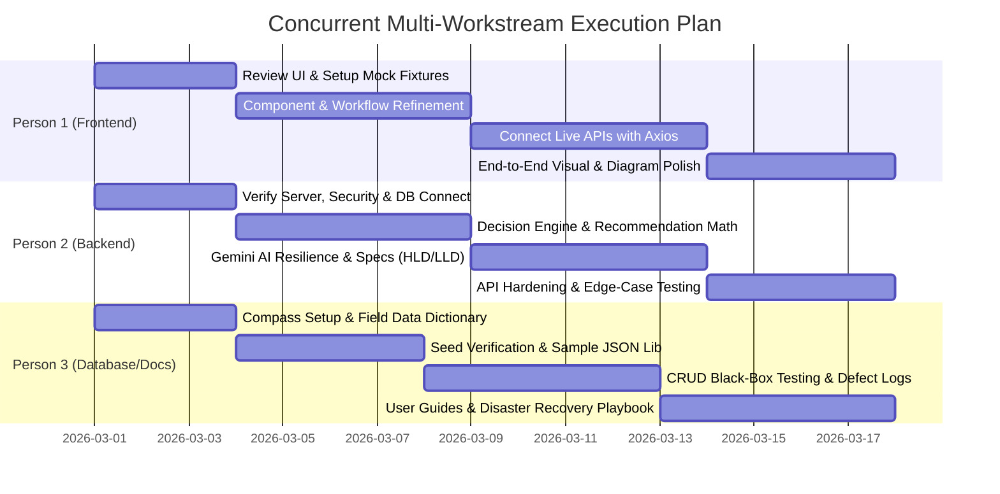

# Task Breakdown & Dependency Matrix

## 1. Parallel Workstream Model

To maximize team productivity, work is structured so that **Person 1 (Frontend)**, **Person 2 (Backend)**, and **Person 3 (Database & Documentation)** can work concurrently from Day 1.

---

## 2. Person 1 (Frontend Developer) Task Breakdown

| Task ID | Stage | Task Name | Priority | Estimated Effort | Dependencies | Completion Criteria |
| :--- | :--- | :--- | :--- | :--- | :--- | :--- |
| **P1-T1** | Immediate | Audit existing React pages and install missing dependencies | Critical | 1 Day | None | `npm run dev` launches with 0 compilation errors |
| **P1-T2** | Immediate | Build mock JSON fixture library in `client/src/mocks/` | High | 2 Days | P1-T1 | Mock toggles allow viewing all pages offline |
| **P1-T3** | Short-Term | Refactor form state and validations in `RequirementsPage.jsx` | High | 2 Days | P1-T2 | Multi-tab form captures all SLA/traffic inputs cleanly |
| **P1-T4** | Short-Term | Polish `RecommendationsPage.jsx` weight sliders & score bars | High | 2 Days | P1-T2 | Moving sliders updates weights; recalculate triggers smoothly |
| **P1-T5** | Short-Term | Enhance `MermaidViewer.jsx` zoom/pan and export features | Medium | 2 Days | P1-T2 | Diagrams pan smoothly; SVG/PNG downloads work reliably |
| **P1-T6** | Integration | Connect Auth pages to backend (`/api/auth/login`, `register`) | Critical | 1.5 Days | P2-T1 | Successful login sets JWT and routes to Dashboard |
| **P1-T7** | Integration | Connect Project CRUD and Requirements to backend APIs | High | 2 Days | P2-T2, P1-T6 | Project creation persists and redirects to requirements |
| **P1-T8** | Integration | Connect Decision engines (Recommendations, Compare, Explain) | High | 2.5 Days | P2-T3, P2-T4 | Dynamic stacks and AI accordion sections display live |
| **P1-T9** | Integration | Connect HLD, LLD, Diagrams, Scenarios, and Reports | High | 2.5 Days | P2-T5, P2-T6 | Diagrams render dynamically; reports download as `.md` |
| **P1-T10** | Testing | Responsive design polish across Mobile, Tablet, and Desktop | High | 2 Days | All P1 tasks | UI is responsive across screen widths (375px to 1920px) |
| **P1-T11** | Deliverable | Final end-to-end frontend sign-off and build validation | Critical | 1 Day | P1-T10 | `npm run build` generates optimized production bundle |

---

## 3. Person 2 (Backend Developer) Task Breakdown

| Task ID | Stage | Task Name | Priority | Estimated Effort | Dependencies | Completion Criteria |
| :--- | :--- | :--- | :--- | :--- | :--- | :--- |
| **P2-T1** | Immediate | Verify Express server bootstrap, rate limiters, and MongoDB connection | Critical | 1.5 Days | None | Server starts; `/api/health` returns status healthy |
| **P2-T2** | Immediate | Verify JWT auth routes and User model password hashing | Critical | 1.5 Days | P2-T1 | Registration hashes passwords; login returns valid JWT |
| **P2-T3** | Short-Term | Test and verify Requirement Analyzer and Recommendation Engine | Critical | 2.5 Days | P2-T1, P3-T3 | Multi-criteria scoring returns ranked stacks correctly |
| **P2-T4** | Short-Term | Implement and verify Gemini AI Explainer with 25s timeout & fallback | Critical | 2 Days | P2-T3 | Endpoint returns 10 sections; fallback triggers on bad API key |
| **P2-T5** | Short-Term | Test HLD, LLD, and Mermaid Diagram syntax generators | High | 2 Days | P2-T3 | Generated diagrams parse cleanly in Mermaid without errors |
| **P2-T6** | Short-Term | Verify Validation, Scenario Simulation, and Capacity/Cost Services | High | 2 Days | P2-T3 | Mathematical formulas calculate accurate OpEx and sizing |
| **P2-T7** | Integration | Integrate Project model persistence with all 11 sub-controllers | Critical | 3 Days | P2-T2 to P2-T6 | Project document updates atomically across all stages |
| **P2-T8** | Integration | Coordinate with Person 3 on seed data and database verification | High | 1.5 Days | P3-T4 | Seed scripts populate 20+ technologies and demo project |
| **P2-T9** | Testing | Implement route validation unit tests and error handling checks | High | 2 Days | P2-T7 | Invalid IDs return 404; missing fields return 400 |
| **P2-T10** | Deliverable | Security audit and final backend production readiness review | Critical | 1 Day | All P2 tasks | Helmet, CORS, and rate limiting active; zero leaks |

---

## 4. Person 3 (Database & Documentation) Task Breakdown

| Task ID | Stage | Task Name | Priority | Estimated Effort | Dependencies | Completion Criteria |
| :--- | :--- | :--- | :--- | :--- | :--- | :--- |
| **P3-T1** | Immediate | Install MongoDB Compass and verify local / Atlas database connection | Critical | 1 Day | None | Compass successfully connects and lists databases |
| **P3-T2** | Immediate | Audit existing pages and complete Field-Level Data Dictionary | High | 2 Days | P3-T1 | All fields in `Project`, `User`, `Technology` documented |
| **P3-T3** | Immediate | Review and verify 20+ catalog records in `server/seed/techSeeder.js` | High | 1.5 Days | P3-T1 | Verified all score values are integers between 1 and 10 |
| **P3-T4** | Short-Term | Execute seed scripts and verify documents inside MongoDB Compass | High | 1.5 Days | P3-T3, P2-T1 | `technologies` has $\ge 20$ docs; demo project exists |
| **P3-T5** | Short-Term | Build Sample JSON Document repository for all collections | Medium | 2 Days | P3-T2 | Valid JSON files saved for quick reference and mock use |
| **P3-T6** | Integration | Execute CRUD Black-Box testing via Postman / Thunder Client | High | 3 Days | P2-T7 | All 15 controller routes verified and documented |
| **P3-T7** | Integration | Verify data persistence and password hashing via Compass | Critical | 2 Days | P2-T7 | Verified passwords hashed; project sub-docs persist |
| **P3-T8** | Integration | Maintain Defect Log and track bug resolutions with P1 & P2 | High | Continuous | P3-T6 | All identified defects logged with reproduction steps |
| **P3-T9** | Testing | Document and test database backup and restore (`mongodump`) | Medium | 1.5 Days | P3-T4 | Test restore into clean database succeeds completely |
| **P3-T10** | Deliverable | Finalize System User Guide and Architecture Dossier Archive | High | 2 Days | All tasks | Complete technical documentation binder ready for submission |

---

## 5. Dependency & Coordination Matrix

The following table shows how tasks across team members interface:

| Phase | Person 1 (Frontend) | Person 2 (Backend) | Person 3 (Database & Docs) | Blocking Dependencies |
| :--- | :--- | :--- | :--- | :--- |
| **Day 1–3** | P1-T1, P1-T2 (Setup & Mocks) | P2-T1, P2-T2 (Server & Auth) | P3-T1, P3-T2, P3-T3 (Compass & Data Dict) | **None** (100% Parallel) |
| **Day 4–7** | P1-T3, P1-T4, P1-T5 (Forms & UI) | P2-T3, P2-T4, P2-T5 (Engines & AI) | P3-T4, P3-T5 (Seed Verification) | P3-T4 requires P2-T1 (DB connect) |
| **Day 8–11** | P1-T6, P1-T7 (Auth & Project APIs) | P2-T6, P2-T7 (Persistence & APIs) | P3-T6, P3-T7 (Black-Box & Compass Checks) | P1-T6 needs P2-T2; P1-T7 needs P2-T7 |
| **Day 12–14** | P1-T8, P1-T9 (Engines & Diagrams) | P2-T8, P2-T9 (Tests & Coordination) | P3-T8, P3-T9 (Defects & Backup Guides) | P1-T8 needs P2-T3/T4; P1-T9 needs P2-T5 |
| **Day 15** | P1-T10, P1-T11 (Polish & Build) | P2-T10 (Security Audit) | P3-T10 (Final Docs & Submission) | All integration tasks completed |
